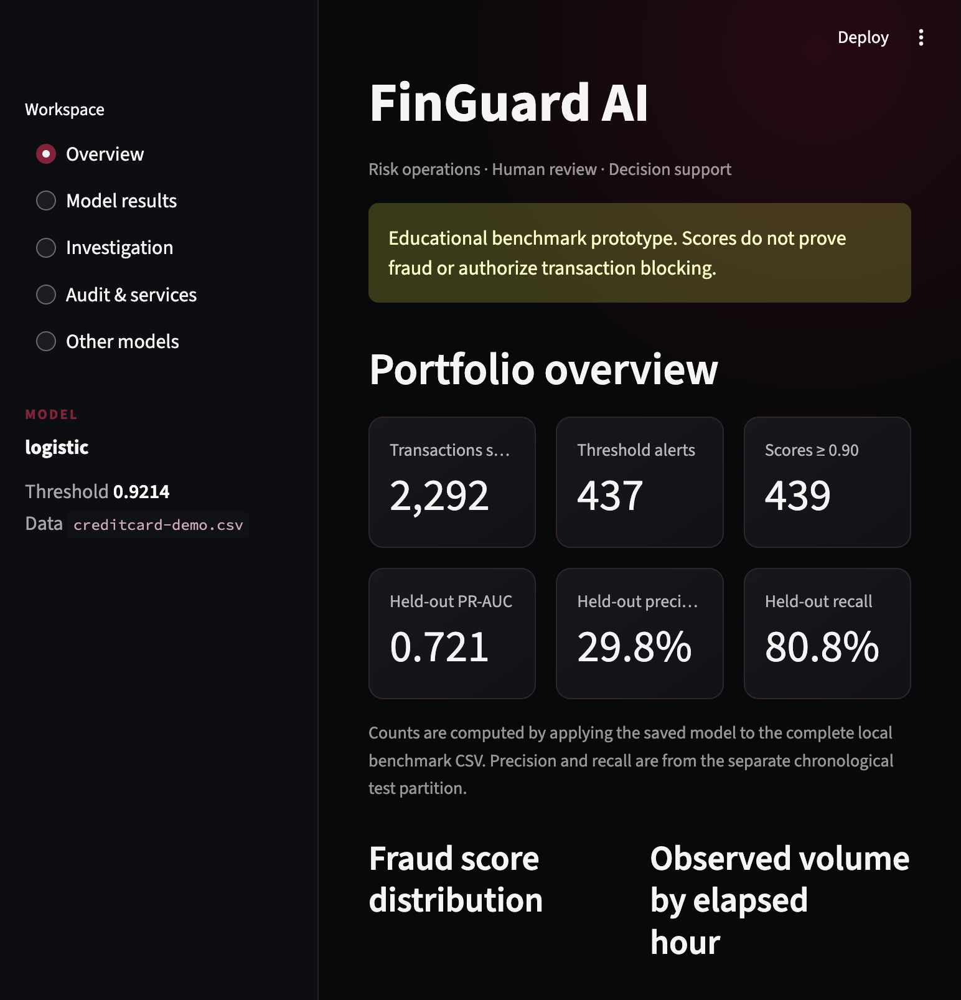
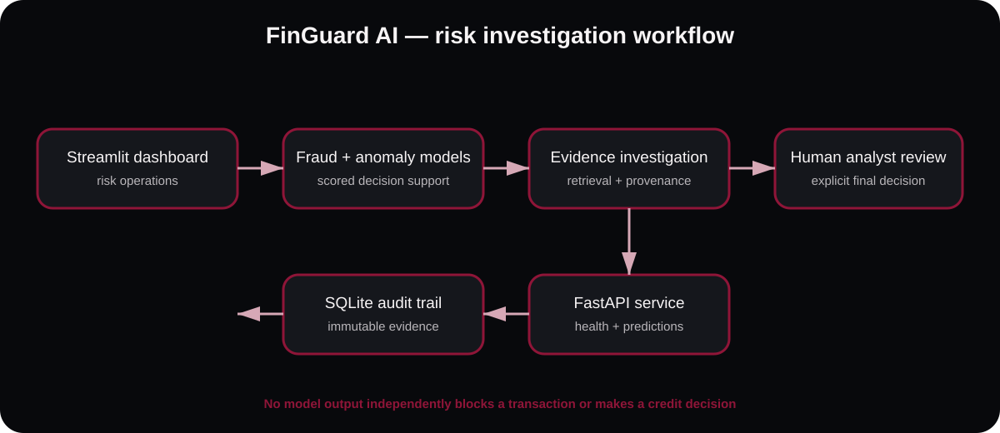

<div align="center">
  

  [](https://github.com/KrushnaManke/FinGuard-AI/actions/workflows/ci.yml)
  [](https://www.python.org/)
  [](https://streamlit.io/)
  [](LICENSE)

  **Decision-support for fraud analysts — not a replacement for human judgment.**

  [Open live demo](https://finguard-ai-4otf.onrender.com) · [Run locally](#quick-start) · [Architecture](#architecture) · [Contributing](CONTRIBUTING.md)
</div>

> **Responsible use:** FinGuard is an educational portfolio project using public benchmark data. Scores can support review, but must never independently block a transaction or make a credit decision.

# FinGuard AI

Educational fraud detection and financial investigation platform. This repository now implements a local end-to-end MVP plus optional modules for boosted models, explanations, credit scoring, forecasting, an API, compliance retrieval, agent workflow, experiment tracking, monitoring, and cloud/container setup.

> **Safety and scope:** This is a learning prototype, not a production banking or compliance system. Model outputs are decision support only. No model or LLM should independently block a transaction, freeze an account, or make a credit decision.

## Why FinGuard

| Challenge | FinGuard approach |
|---|---|
| Raw anomaly scores are difficult to operationalize | Chronological validation and a configurable review threshold |
| Model metrics need a trustworthy comparison | Held-out test report plus an all-negative baseline |
| Explainability should not invent business facts | Fraud/anomaly outputs remain separate; evidence provenance is explicit |
| Investigations lose accountability | SQLite audit trail, source excerpts, review status, and JSON export |
| Public demos need safe artifacts | A 2,292-row realistic demo subset is included; no secrets or customer data |

## Live dashboard

The hosted experience uses a public demo dataset and dark burgundy analyst interface. Every suspicious score still requires human review.

[**Open FinGuard AI live**](https://finguard-ai-4otf.onrender.com). Hosted on Render with the tracked demo dataset, trained models, evaluation report, and deployment-ready configuration. Free-instance services may take a moment to wake after inactivity.

<p align="center">
  
</p>

## Architecture



The dashboard can also expose a FastAPI service. API requests share the SQLite audit store used by the analyst workflow.

## What is implemented

| Roadmap skills | Project implementation |
|---|---|
| Python, Pandas, EDA | Schema validation, class counts, duplicate reporting, and summaries in `src/finguard/data.py` |
| Feature engineering, imbalanced classification | Log amount/elapsed-cycle features; class-weighted logistic baseline and validation-capacity threshold selection |
| XGBoost, anomaly detection, SHAP | Optional XGBoost/LightGBM training, Isolation Forest, optional SHAP attribution |
| Credit risk, LightGBM | Separate generic binary-credit trainer; requires a separate data file and target |
| Forecasting, SQL | Daily alert-count seasonal-naive forecast with holdout MAE; SQLite prediction/review audit tables |
| FastAPI, Pydantic | `/health`, `/v1/predict`, `/v1/investigations`, `/v1/reviews`; bearer-key support |
| Streamlit, Plotly | Dashboard, alert queue, transaction details, separate synthetic context, analyst review, persisted evidence report |
| LLM, embeddings, vector database | Relevance-thresholded local TF-IDF retrieval; optional Chroma/OpenAI embeddings and source-gated evidence-constrained drafts |
| LangGraph | Optional graph wrapping the retrieval/evidence investigation step |
| MLflow, W&B, Docker | Optional experiment tracking, Dockerfile, Compose, automated image build |
| AWS EC2, S3, IAM, GitHub Actions | S3 upload helper, private encrypted bucket template, CI checks; credentials and deployment are user-configured |
| Testing, monitoring, documentation | Pytest suite, PSI drift utility, this guide, CI workflow |

This implements learning paths and usable scaffolding, **not** a production-ready banking deployment. AWS account resources, credentials, legal source material, and credit datasets are intentionally not fabricated or committed.

## Future goals

1. Add richer entity, merchant, and account history to enable stronger graph-based fraud investigations.
2. Integrate calibrated real-time monitoring and explainable alerts with configurable analyst approval workflows.
3. Expand secure multi-tenant deployment with role-based access, audit exports, and production-grade model governance.

## Dataset limitations

`data/raw/creditcard.csv` contains 284,807 rows, 492 fraud labels, a `Time` offset, `Amount`, and anonymized `V1`–`V28` features. It has no customer ID/history, merchant/destination data, currency field, loan fields, or credit-default target.

- Use `Class` only as the fraud label; it is not a credit-default label.
- Do not assign business meanings to `V1`–`V28`.
- The app displays source amounts without assuming a currency.
- Duplicate rows are counted, not automatically dropped.
- Forecasting needs a separate dataset with a real timestamp and sufficient history.
- Credit-default training needs a separately sourced and documented labeled dataset.

## Quick start

```bash
git clone https://github.com/KrushnaManke/FinGuard-AI.git
cd FinGuard-AI
python -m venv .venv
source .venv/bin/activate
python -m pip install -e ".[app,api,test]"
streamlit run app/Home.py
```

The repository ships with a demo dataset, evaluation report, and trained models. No API key or external service is required for the core dashboard.

## Full setup

Python 3.11 is recommended for the full optional dependency set. Check the interpreter available on your machine; the core, API, and test extras have been verified with this project's existing Python 3.9 virtual environment.

```bash
cd "/Users/krishnapradipmanke/FinGuard AI /FinGuard-AI"
python3 --version
python3 -m venv .venv
source .venv/bin/activate
python -m pip install --upgrade pip
python -m pip install -e ".[app,api,test]"
test -f .env || cp .env.example .env
```

Install optional tools as you work through those skills:

```bash
python -m pip install -e ".[boosted]"  # XGBoost, LightGBM
python -m pip install -e ".[explain]"  # SHAP
python -m pip install -e ".[llm]"      # OpenAI SDK, LangGraph, ChromaDB
python -m pip install -e ".[ops]"      # MLflow, W&B, boto3
```

On macOS, boosted-model libraries may also require the OpenMP runtime; for XGBoost, install it with `brew install libomp` if the native library fails to load.

To attempt all optional packages at once:

```bash
python -m pip install -e ".[all]"
```

The `all` extra includes the optional API, boosted models, explainability, LLM/RAG, tracking, AWS SDK, dashboard, and test dependencies. Some features also require external configuration, described below. Keep `.env` secrets out of Git; `.env.example` lists supported setting names.

## Train the fraud and anomaly models

```bash
python -m finguard.train
```

This creates `models/fraud_model.joblib`, `models/anomaly_model.joblib`, and `models/evaluation.json`. The fraud model uses a chronological timestamp-quantile 70/15/15 train/validation/test split. Equal timestamps remain in the same partition. The default alert threshold is selected on the validation partition to target a 0.5% alert rate (adjust with `--validation-alert-fraction`); `--threshold-objective max-f1` is available for comparison. Test metrics are calculated only after threshold selection. Since score ties can exceed an exact quota, the report records both target and actual validation alert counts. The anomaly model produces a separate unusualness score, not a fraud probability.

On the current dataset with the chronological split and default threshold objective, the measured held-out results are about **72.1% PR-AUC**, **29.8% precision**, and **80.8% recall** at the validation-selected threshold. At a fixed budget of 100 highest-scored test alerts, recall is **78.8%** and precision is **41.0%**. The all-negative baseline PR-AUC equals test-set prevalence (~0.12%) and has zero recall. Read exact values and confusion counts in `models/evaluation.json`; these results are benchmark-specific, not a promise of future or real-bank performance.

Run a side-by-side chronological evaluation of logistic regression and XGBoost after installing the boosted extra:

```bash
python -m finguard.compare --algorithms logistic xgboost
```

The comparison command trains separate artifacts under `models/comparison/` and evaluates both models with the same split, threshold objective, baseline, and fixed alert budgets. XGBoost is optional and is not included in the base environment.

Select an optional classifier after installing the boosted extra:

```bash
python -m finguard.train --algorithm xgboost
python -m finguard.train --algorithm lightgbm
```

Optional experiment logging:

```bash
python -m finguard.train --track mlflow
python -m finguard.train --track wandb
```

W&B requires `WANDB_API_KEY`; MLflow logs to its configured/default local tracking store. Model artifacts and reports are ignored by Git.

## Run the dashboard and API

Dashboard:

```bash
streamlit run app/Home.py
```

The dashboard has separate Overview, Model results, Investigation, Audit & services, and Other models views. It scores the local benchmark with the saved fraud/anomaly artifacts and shows the held-out test report, chronological partitions, confusion matrix, all-negative baseline, alert-capacity trade-offs, RAG fixture metrics, and SQLite records. The API health indicator checks the configured local API endpoint. Credit-default and forecasting outputs are shown only when their separately trained report files exist; the dashboard does not invent placeholder results.

API:

```bash
uvicorn finguard.api:app --reload
```

Open `http://127.0.0.1:8000/docs` for the interactive API docs. `POST /v1/predict` scores supplied benchmark-schema features. `POST /v1/investigations` runs scoring, retrieves approved local documents, builds a structured evidence report, and optionally attaches synthetic context when `include_synthetic_demo_context` is explicitly true. The same API score is returned whether that optional context is attached or not.

Prediction request example:

```json
{
  "transaction_id": "demo-001",
  "features": {
    "Time": 0,
    "V1": 0,
    "V2": 0,
    "V3": 0,
    "V4": 0,
    "V5": 0,
    "V6": 0,
    "V7": 0,
    "V8": 0,
    "V9": 0,
    "V10": 0,
    "V11": 0,
    "V12": 0,
    "V13": 0,
    "V14": 0,
    "V15": 0,
    "V16": 0,
    "V17": 0,
    "V18": 0,
    "V19": 0,
    "V20": 0,
    "V21": 0,
    "V22": 0,
    "V23": 0,
    "V24": 0,
    "V25": 0,
    "V26": 0,
    "V27": 0,
    "V28": 0,
    "Amount": 25
  }
}
```

In development, the API can run without a key on localhost. To require bearer auth, set `FINGUARD_API_KEY`. In production (`FINGUARD_ENV=production`), the API refuses to serve prediction/review requests if no key is configured. Do not expose this demo directly to the public internet; add a proper identity gateway, TLS, rate limits, secret rotation, audit retention, and operational review before any real deployment.

Prediction, review, and investigation records are stored locally in `data/processed/finguard.sqlite3` by default. The dashboard and API resolve relative model, compliance, and audit paths from the project root so both services use the same configured database when launched from different working directories. Set `FINGUARD_AUDIT_DB` to an absolute path to use a different shared database. Analyst decisions are separate from model output. Reports preserve benchmark/synthetic data lineage.

The Python implementation is under `src/finguard/`; the `app/` directory contains the Streamlit entry point. The Audit & services view reports the source-module inventory and the availability/timestamps of trained model and evaluation artifacts.

## Credit-default model

Use only a separate CSV with an appropriate documented binary default target:

```bash
python -m finguard.credit --data path/to/credit_data.csv --target defaulted
```

The trainer handles numeric/categorical columns, creates a stratified test split, and saves artifacts under `models/credit/`. Review target meaning, data permissions, fairness, calibration, privacy, and applicable regulations before interpreting results.

## Forecasting

The forecasting utility accepts actual timestamps and a binary alert column. It needs at least 14 daily observations and evaluates on a later holdout:

```bash
python -m finguard.forecast \
  --data path/to/daily_alerts.csv \
  --timestamp timestamp \
  --alert-column alert \
  --horizon 7
```

Its seven-day seasonal-naive output is a baseline, not a long-term forecast. The current card-fraud CSV uses elapsed seconds and is not sufficient for bank-wide forecasting.

## Compliance RAG and investigation workflow

Put only approved `.md` or `.txt` compliance documents in `data/compliance/`; include source title, issuer, publication date, section, and canonical URL in the text. The empty library intentionally yields no policy citations. Retrieval has a conservative minimum relevance score to reduce weak keyword matches. The evaluation fixture lives separately under `data/evaluation/rag_fixtures/`; it is clearly fictional training content and must never be treated as compliance guidance.

Default retrieval is local TF-IDF and does not require an API key. To use OpenAI embeddings in the persistent Chroma backend, install `.[llm]`, set `OPENAI_API_KEY`, and set:

```bash
export FINGUARD_RAG_BACKEND=chroma
```

The dashboard creates an evidence ledger and shows source excerpts. It also labels an attached deterministic synthetic customer-history scenario as **SYNTHETIC DEMO CONTEXT**; those facts are never added to model features or scores. Investigation reports are saved separately in the SQLite audit store.

The demo context is generated on demand from a stable hash of the demo transaction ID and a seeded random generator. This makes the same demo ID repeatable without pretending the customer exists. The CSV row supplies only the benchmark transaction amount/model score; customer history fields and destination familiarity are fictional. The UI/API report explicitly marks this data lineage.

If `OPENAI_API_KEY` is configured, the optional LLM action drafts a summary only when relevant documents are retrieved and passes the evidence ledger plus source excerpts. Generated text remains unverified draft content; exact filename citations are checked against retrieved sources, but this does not prove semantic faithfulness. The UI shows provider latency and token counts. Set `FINGUARD_LLM_INPUT_COST_PER_1M` and `FINGUARD_LLM_OUTPUT_COST_PER_1M` to calculate estimated cost for your configured model; otherwise cost is explicitly unavailable. No LLM is called by the offline evaluation.

Run the deterministic retrieval/evidence test set:

```bash
python -m finguard.rag_evaluation
```

This writes `reports/rag_evaluation.json` with evidence-ledger consistency, citation precision/recall, missing-information accuracy, failure rate, local retrieval latency, and LLM cost (zero because no LLM is called). The scenarios and policy fixture are synthetic. These checks do **not** substitute for human adjudication of LLM truthfulness; model-based LLM faithfulness, real-provider latency, and token cost remain unevaluated until a controlled evaluation set and provider are configured.

## Monitoring, containers, and AWS

`population_stability_index` in `src/finguard/monitoring.py` compares numeric reference/current distributions. It is a monitoring signal, not a drift diagnosis or automatic retraining trigger.

Build and run the local containers after model training:

```bash
docker compose build
docker compose up
```

The dashboard/API ports bind to localhost. Compose mounts the model artifacts and local data; do not put real customer data into this educational deployment.

`infra/secure-artifact-bucket.yaml` creates a versioned, encrypted, public-access-blocked S3 bucket with scoped role permissions. `infra/private-ec2.yaml` provisions a private-subnet, encrypted, IMDSv2-required, SSM-managed EC2 host using an existing VPC security group; the subnet must have suitable outbound access or VPC endpoints. `finguard.aws_storage.upload_artifact` and `download_artifact` use the caller's AWS credential chain.

`infra/ecr-repository.yaml` provisions a private ECR repository with immutable tags and scan-on-push. `.github/workflows/ci.yml` runs tests, syntax checks, and a Docker build on pushes and pull requests. The manual `.github/workflows/publish-ecr.yml` uses GitHub OIDC (not long-lived AWS keys) and requires repository variables `AWS_PUBLISH_ROLE_ARN`, `AWS_REGION`, and `ECR_REPOSITORY`. Configure the AWS trust policy to trust only this repository/workflow and restrict it to pushing to the target ECR repository. These templates do not create an internet-facing service or automatically deploy to production.

## Tests

```bash
pytest
python -m compileall -q src app tests
```

Tests cover data validation, features, model metrics, chronological split/training behavior, synthetic-context separation, credit training, API schemas/authorization/investigation, local retrieval, SQLite audit storage, forecasting, and drift metrics. The dataset itself is not copied into test fixtures.
